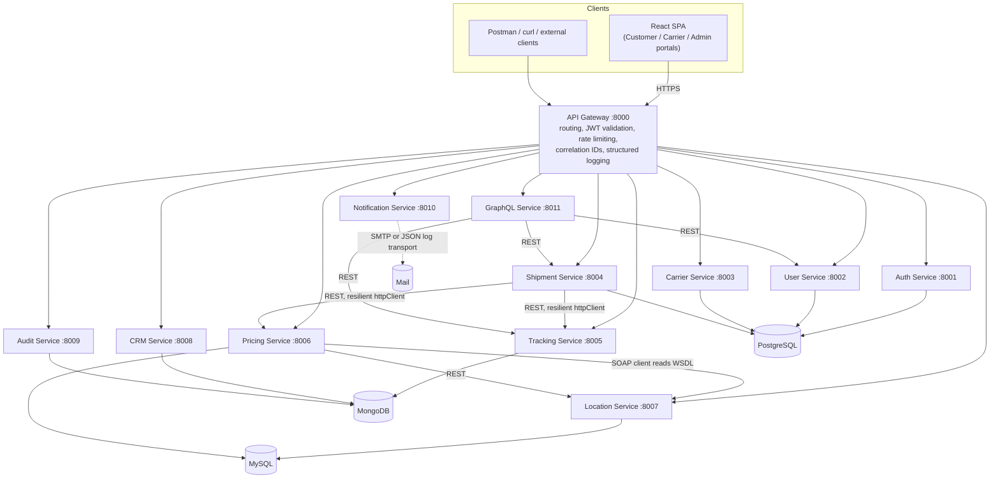
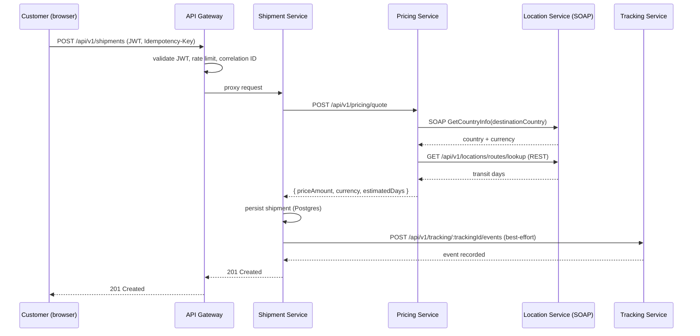

# ShipTrack Architecture

## High-Level Architecture

## Microservices Map

| Service | Port | Database | Responsibilities |
|---|---|---|---|
| api-gateway | 8000 | - | Routing, gateway-level JWT validation, rate limiting, correlation IDs, structured logging |
| auth-service | 8001 | PostgreSQL (`auth_db`) | Register (customer), login, refresh/logout, admin-provisioned carrier/admin accounts |
| user-service | 8002 | PostgreSQL (`user_db`) | Customer profile CRUD |
| carrier-service | 8003 | PostgreSQL (`carrier_db`) | Carrier profile CRUD, admin verification |
| shipment-service | 8004 | PostgreSQL (`shipment_db`) | Create/update shipments, delivery info, public tracking lookup, shipment history |
| tracking-service | 8005 | MongoDB (`tracking_db`) | Tracking events, status history |
| pricing-service | 8006 | MySQL (`pricing_db`) | Shipping cost calculation, pricing rules, SOAP currency conversion |
| location-service | 8007 | MySQL (`location_db`) | Countries, cities, warehouses, delivery routes, SOAP country info |
| crm-service | 8008 | MongoDB (`crm_db`) | Customer/shipment/carrier analytics (event-sourced aggregation) |
| audit-service | 8009 | MongoDB (`audit_db`) | Audit logs, security events, API request logs |
| notification-service | 8010 | - | Email notifications (SMTP or JSON/log transport) |
| graphql-service | 8011 | - | Aggregated shipment/tracking/customer-dashboard queries |

## Communication Patterns

- **REST** is the primary inter-service and client-facing protocol; every service exposes `/api/v1/...` routes and its own hand-written `openapi.yaml` served at `/api-docs`.
- **GraphQL** (`graphql-service`) aggregates REST calls to shipment/tracking/user services behind a single query surface for dashboard-style reads.
- **SOAP**: `location-service` exposes a WSDL-described `CountryInfoService`; `pricing-service` reads that WSDL and performs real SOAP requests against it while calculating quotes, and also exposes its own SOAP `CurrencyConversionService`.
- **Resilience**: every outbound REST call between services goes through `@shiptrack/common`'s `createServiceClient` - timeout, exponential-backoff retry, and an Opossum circuit breaker with a per-call fallback (e.g. shipment→tracking degrades to a no-op if tracking-service is down; pricing→location's REST route lookup falls back to a default transit estimate).

## Request Lifecycle (example: create shipment)

