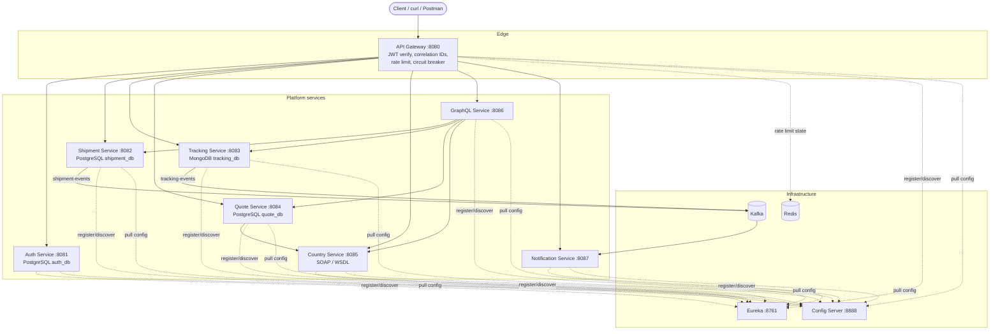
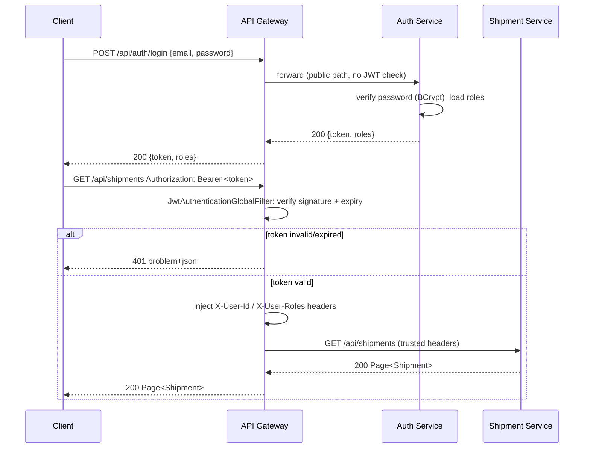
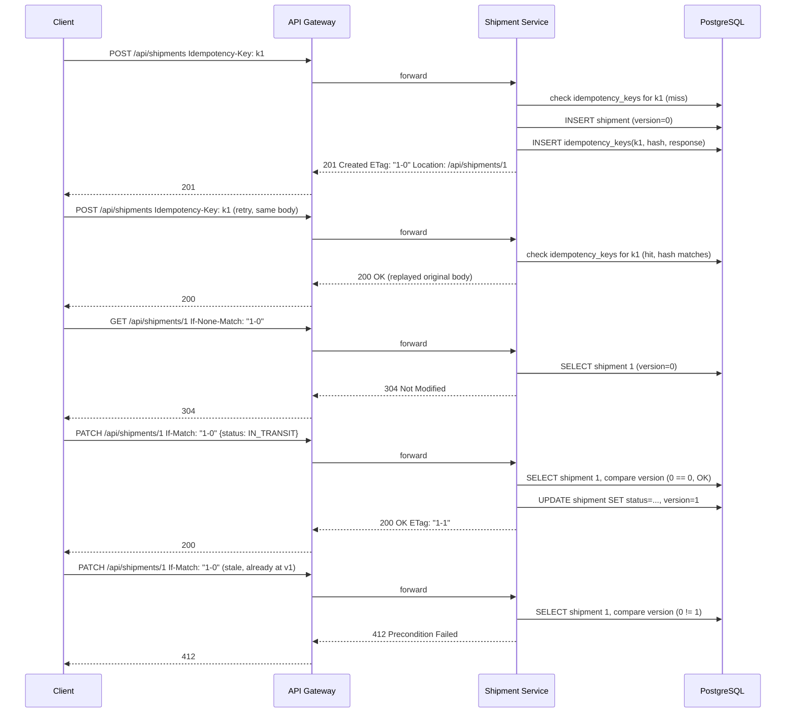
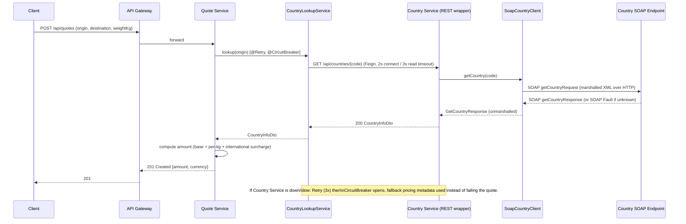
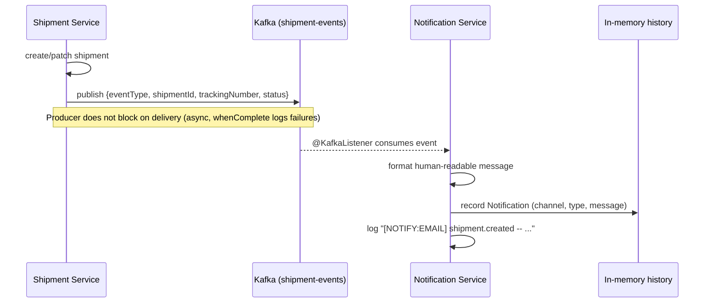
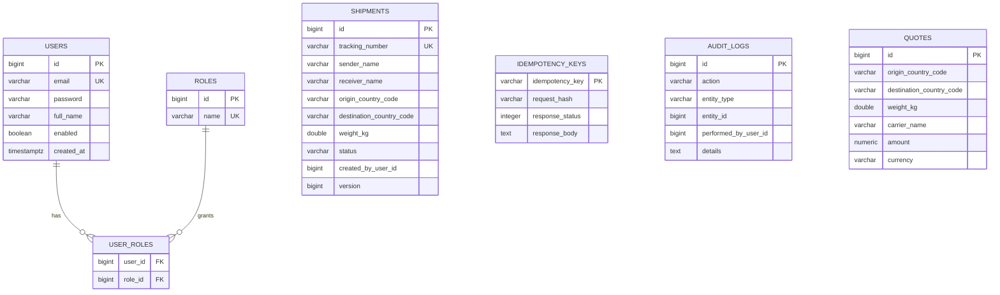
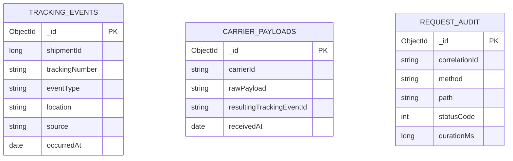
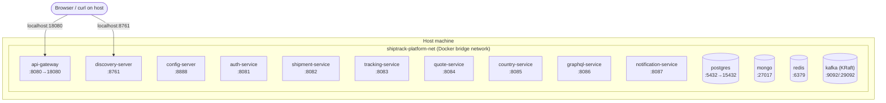
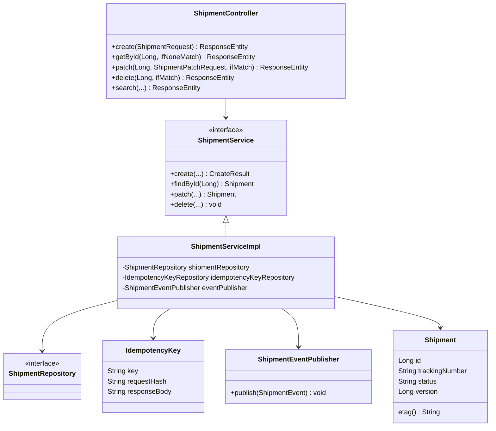

# ShipTrack — Diagrams

## 1. Architecture / microservice communication

## 2. Sequence — JWT login and a gateway-protected call

## 3. Sequence — ETag / idempotency / optimistic locking

## 4. Sequence — Quote request (SOAP + Resilience4j)

## 5. Sequence — Async notification via Kafka

## 6. Entity-Relationship diagram (PostgreSQL)

> `auth_db`, `shipment_db` and `quote_db` are three separate PostgreSQL databases in one
> container (database-per-service) — there are no cross-database foreign keys; `SHIPMENTS` and
> `QUOTES` reference `USERS.id` only logically, via the JWT-derived `X-User-Id` header.

## 7. MongoDB collections (Tracking Service)

## 8. Deployment diagram (Docker Compose)

## 9. Class diagram — Shipment Service core

