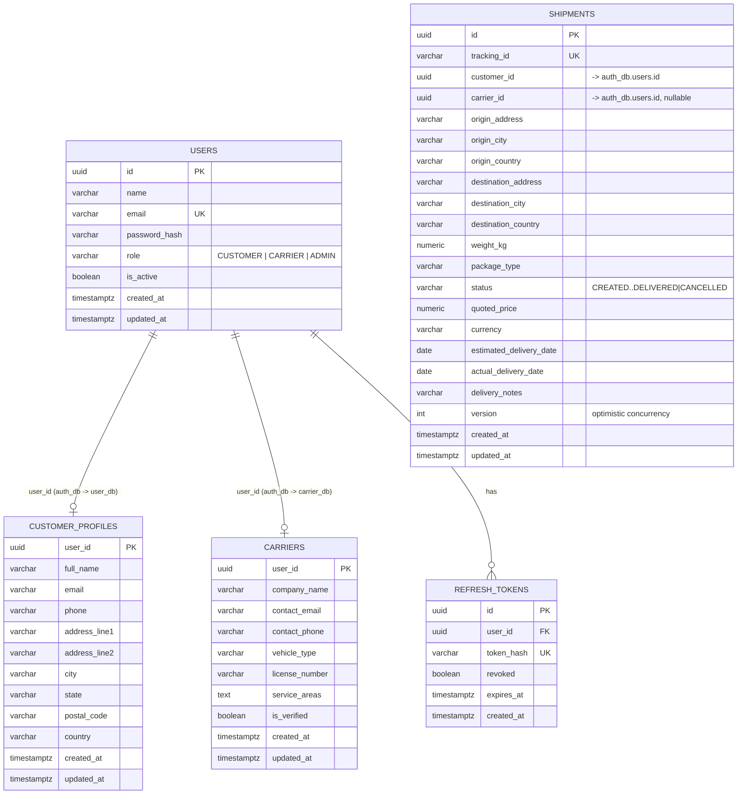
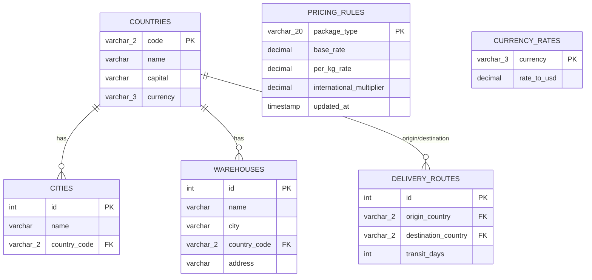
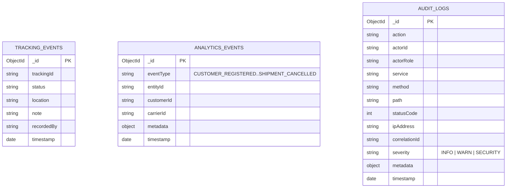

# ShipTrack Data Model

## PostgreSQL (auth-service, user-service, carrier-service, shipment-service)

Each service owns its own database (`auth_db`, `user_db`, `carrier_db`, `shipment_db`) on the
same Postgres instance - no cross-service foreign keys, only shared `user_id` values that are
UUIDs minted by `auth-service`.

## MySQL (location-service, pricing-service)

(`pricing_db` and `location_db` are separate MySQL databases on the same server -
`PRICING_RULES`/`CURRENCY_RATES` live in `pricing_db`; the rest live in `location_db`.
`pricing-service` reaches `location-service` over SOAP/REST rather than a DB join.)

## MongoDB Collections (tracking-service, crm-service, audit-service)

Each collection lives in its own database (`tracking_db`, `crm_db`, `audit_db`) on the same
MongoDB instance. All three are append-mostly event logs - `crm-service`'s aggregation
pipelines compute analytics on read rather than maintaining separate rollup documents.
