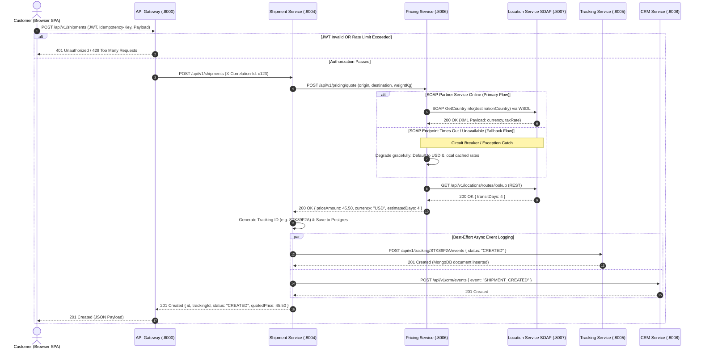
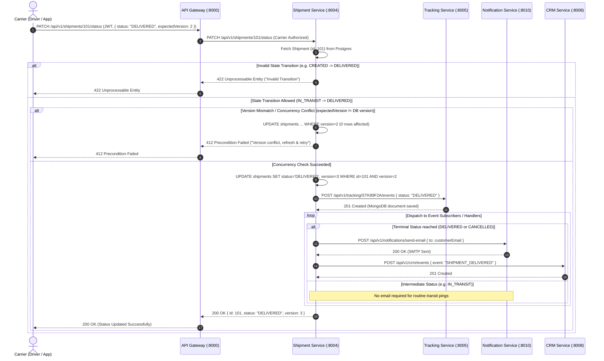
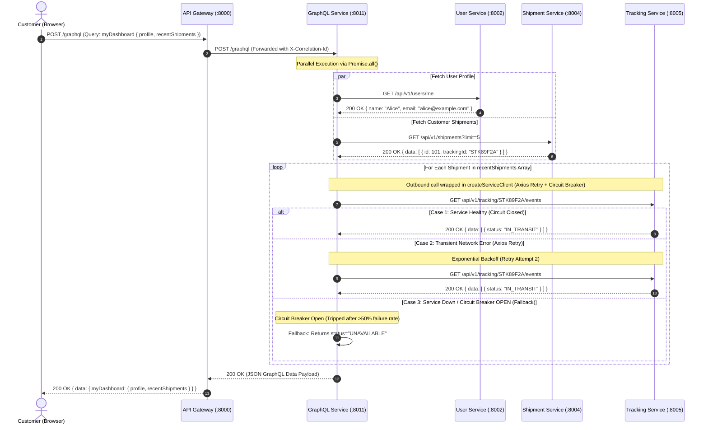

# 📦 ShipTrack - 3 Sequence Diagrams & Easy Viva Cheat Sheet

A clear, simplified guide to the 3 core architectural scenarios in **ShipTrack**. Designed for quick reading and easy viva presentation.

---

## ⚡ Quick Summary Table

| Scenario | Primary Actor | What Happens? | Key Diagrams & Controls |
|---|---|---|---|
| **1. Create Shipment** | `Customer` | Customer creates a package $\rightarrow$ Gateway validates token $\rightarrow$ Pricing Service calls Location Service via **SOAP WSDL** $\rightarrow$ Saved to DB $\rightarrow$ Tracking started. | `alt` (Auth check, SOAP Fallback), `par` (Async logging) |
| **2. Carrier Update** | `Carrier` | Carrier marks shipment as `DELIVERED` $\rightarrow$ Checks valid transition & version $\rightarrow$ Saves status $\rightarrow$ Emails customer. | `alt` (Validation, Version check), `loop` (Email notify) |
| **3. Customer Dashboard** | `Customer` | Customer opens dashboard $\rightarrow$ **GraphQL** fetches profile & shipments in 1 request $\rightarrow$ Handles failures gracefully without crashing. | `loop` (Shipment list), `alt` (Circuit Breaker fallback) |

---

> [!IMPORTANT]
> ### ⏱️ 30-Second Viva Summary (Memorize This!)
> 1. **Scenario 1 (Create Shipment)**: Customer creates shipment $\rightarrow$ Gateway validates token $\rightarrow$ Pricing Service calls Location Service via **SOAP WSDL** $\rightarrow$ If SOAP fails (`alt`), fallback to USD $\rightarrow$ Saved to PostgreSQL.
> 2. **Scenario 2 (Carrier Update)**: Carrier updates status to `DELIVERED` $\rightarrow$ Checks valid transition (`alt`: 422 error if invalid) $\rightarrow$ Checks version (`alt`: 412 error if conflict) $\rightarrow$ Saves to DB $\rightarrow$ Loops (`loop`) to send email alert to Customer.
> 3. **Scenario 3 (GraphQL Dashboard)**: Customer opens dashboard $\rightarrow$ **GraphQL Service** fetches Profile & Shipments in parallel (`par`) $\rightarrow$ Loops (`loop`) to get tracking details $\rightarrow$ If Tracking Service is down, Circuit Breaker (`alt`) returns fallback status `"UNAVAILABLE"` without crashing.

---

## 🔹 Scenario 1: Creating a Shipment & Dynamic Pricing (SOAP Integration)

### 📌 Simple Story
1. **Customer** submits a new shipment request on the website.
2. **API Gateway** checks if the user is logged in (valid JWT token).
3. **Shipment Service** asks **Pricing Service** for the total cost.
4. **Pricing Service** calls **Location Service** using **SOAP WSDL** (`GetCountryInfo`) to get the country currency & route transit time.
   - *Fallback (`alt`)*: If SOAP service is down, pricing defaults to USD currency so creation doesn't fail!
5. **Shipment Service** saves the shipment in **PostgreSQL**.
6. **Tracking Service** & **CRM Service** receive non-blocking event logs in **MongoDB** (`par`).

### 👥 Actors & Lifelines
- **Actor**: `Customer` (User)
- **Lifelines**: 
  1. `API Gateway (:8000)` - Security & Routing
  2. `Shipment Service (:8004)` - Main Shipment Logic (PostgreSQL)
  3. `Pricing Service (:8006)` - Cost Calculation (MySQL)
  4. `Location Service SOAP (:8007)` - Country Data (SOAP WSDL)
  5. `Tracking Service (:8005)` - Tracking History (MongoDB)
  6. `CRM Service (:8008)` - Analytics (MongoDB)

### ✉️ Key Messages
- `POST /api/v1/shipments` $\rightarrow$ `POST /api/v1/pricing/quote` $\rightarrow$ `SOAP GetCountryInfo` $\rightarrow$ `201 Created`

---

### 🎨 Visual Diagram: Scenario 1

### 📊 Sequence Diagram (Mermaid)

---

### 🎓 Quick Viva Q&A for Scenario 1

- **Q1: Why use SOAP here?**
  - **Answer**: `Location Service` exposes legacy partner data over SOAP XML WSDL. It demonstrates REST-to-SOAP hybrid integration.
- **Q2: Why is there an `alt` block around SOAP?**
  - **Answer**: If the SOAP partner endpoint is down or times out, the `alt` fallback catches the error and defaults to USD pricing so shipment creation does not crash.
- **Q3: Why use PostgreSQL for shipments and MongoDB for tracking?**
  - **Answer**: PostgreSQL provides ACID transactions for critical financial/shipment data. MongoDB provides fast append-only storage for high-frequency tracking events.

---

## 🔹 Scenario 2: Carrier Shipment Status Update & Customer Notification

### 📌 Simple Story
1. **Carrier** (driver) updates shipment status to `DELIVERED`.
2. **API Gateway** checks if the user has the `CARRIER` role.
3. **Shipment Service** checks:
   - *State Machine Check (`alt`)*: Is `IN_TRANSIT` $\rightarrow$ `DELIVERED` allowed? (Jumping `CREATED` $\rightarrow$ `DELIVERED` returns a `422` error).
   - *Concurrency Check (`alt`)*: Does `expectedVersion` match database version? (Prevents overwrite conflicts, returns a `412` error on conflict).
4. **Shipment Service** updates status in PostgreSQL (`version = version + 1`).
5. **Notification Loop (`loop`)**:
   - Saves event log in **MongoDB**.
   - If terminal status (`DELIVERED`), sends email notification to Customer via **Notification Service** (SMTP) and records CRM event.

### 👥 Actors & Lifelines
- **Actor**: `Carrier` (Driver)
- **Lifelines**: 
  1. `API Gateway (:8000)`
  2. `Shipment Service (:8004)` - State & Concurrency Check
  3. `Tracking Service (:8005)` - Mongo Event Log
  4. `Notification Service (:8010)` - Customer Email (SMTP)
  5. `CRM Service (:8008)` - Analytics Event

### ✉️ Key Messages
- `PATCH /api/v1/shipments/101/status` `{ status: "DELIVERED", expectedVersion: 2 }` $\rightarrow$ `200 OK`

---

### 🎨 Visual Diagram: Scenario 2

### 📊 Sequence Diagram (Mermaid)

---

### 🎓 Quick Viva Q&A for Scenario 2

- **Q1: What is Optimistic Concurrency Control (OCC)?**
  - **Answer**: Instead of locking the database row, we check `expectedVersion`. If another user updated the row first, the version changes and our query updates 0 rows, returning `412 Precondition Failed`.
- **Q2: What is the purpose of the `loop` block here?**
  - **Answer**: It loops through subscribers to handle event notification fan-out (sending customer emails on `DELIVERED` and logging tracking events).

---

## 🔹 Scenario 3: GraphQL Dashboard Aggregation with Circuit Breaker

### 📌 Simple Story
1. **Customer** opens their dashboard. The website sends **ONE** GraphQL query (`myDashboard`).
2. **GraphQL Service** fetches data in parallel (`par`):
   - User profile from `User Service`.
   - Active shipments list from `Shipment Service`.
3. **GraphQL Service** loops (`loop`) over each shipment to fetch its tracking history from `Tracking Service`.
4. **Resilience (`alt`)**:
   - *Healthy*: Returns full tracking event list (`200 OK`).
   - *Retry*: Automatically retries 3 times on transient network errors.
   - *Service Down (Circuit Breaker OPEN)*: Returns fallback payload `{ status: "UNAVAILABLE" }` so the user dashboard still loads gracefully!

### 👥 Actors & Lifelines
- **Actor**: `Customer`
- **Lifelines**: 
  1. `API Gateway (:8000)`
  2. `GraphQL Service (:8011)` - Aggregator Gateway
  3. `User Service (:8002)` - User Profile
  4. `Shipment Service (:8004)` - Active Shipments
  5. `Tracking Service (:8005)` - Tracking Details

### ✉️ Key Messages
- `POST /graphql` `{ query { myDashboard { profile recentShipments } } }` $\rightarrow$ `200 OK`

---

### 🎨 Visual Diagram: Scenario 3

### 📊 Sequence Diagram (Mermaid)

---

### 🎓 Quick Viva Q&A for Scenario 3

- **Q1: Why use GraphQL here instead of REST?**
  - **Answer**: GraphQL aggregates data from 3 separate microservices into 1 single request, preventing over-fetching and multiple network round-trips from the browser.
- **Q2: How does the Circuit Breaker work?**
  - **Answer**: Built using Opossum. If `Tracking Service` fails >50% of the time, the breaker "trips open" and immediately returns a fallback without waiting for timeouts, protecting the system from cascading failure.

---

## 💡 Top 5 General Viva Tips for Sequence Diagrams

1. **Actors vs Lifelines**: An **Actor** is a human user (Customer, Carrier), while a **Lifeline** is a software service (`API Gateway`, `Shipment Service`).
2. **Solid vs Dashed Arrows**: Solid arrow (`->>`) is a synchronous request; dashed arrow (`-->>`) is a response message.
3. **`alt` Block**: Represents conditional logic (`if / else`). Used for error handling, permission checks, and fallback paths.
4. **`loop` Block**: Represents repeating logic (`for / foreach`). Used for processing arrays or notifying multiple subscribers.
5. **Correlation ID (`X-Correlation-Id`)**: Passed across all microservices so you can trace a single request across all service logs.
